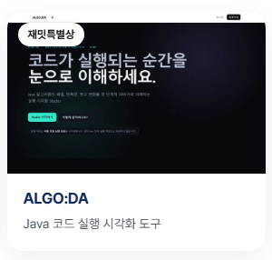

# ALGO:DA · 알고다

> 코드가 실행되는 순간을 눈으로 이해하세요.

Java 알고리즘의 실행 흐름을 단계별로 살펴보는 학습용 웹 프로젝트입니다. 코드의 결과뿐 아니라 배열, 변수, 반복문과 조건문의 상태 변화를 함께 보여주어, 처음 알고리즘을 배우는 사람도 동작 과정을 따라갈 수 있도록 기획했습니다.

**🏆 재밋특별상 수상** · **현재 단계: 프런트엔드 프로토타입**



[공개 데모 보기](https://wv1787545699134777.zaemit.ai/)

## 프로젝트를 시작한 이유

MCP(Model Context Protocol)를 잘 알지 못했던 만큼, 직접 프로젝트를 진행하며 이해해 보고 싶었습니다. 재밋(Zaemit)의 MCP를 ChatGPT에 연결해 아이디어를 실제 웹사이트로 만드는 과정을 경험하는 것이 이 프로젝트의 출발점입니다.

학습 주제로는 Java 알고리즘 실행 시각화를 선택했습니다. 알고리즘을 공부할 때 최종 출력만으로는 반복문이 어떻게 움직이고 배열의 값이 언제 바뀌는지 파악하기 어렵습니다. 이 과정을 한 단계씩 재생하고 되짚어 볼 수 있다면 코드의 동작 원리를 더 쉽게 이해할 수 있다고 생각했습니다.

ALGO:DA는 **Algorithm의 ALGO**와 **“알고 싶다”, “알고 있다”**의 의미를 담은 이름입니다. MCP를 활용한 제작 경험에서 시작해, 앞으로 백엔드를 더해 실제 Java 코드 실행과 분석을 지원하는 서비스로 발전시키고자 합니다.

## 수상 및 제작 과정

- **수상:** 재밋특별상
- **제작 방식:** ChatGPT에 재밋 MCP를 연결하여 사이트 제작 및 발행
- **원본 사이트:** [재밋에서 발행한 ALGO:DA](https://wv1787545699134777.zaemit.ai/)
- **이 저장소:** 공개 사이트에서 복원한 정적 프런트엔드 코드로, 포트폴리오와 향후 개발의 기반으로 활용

MCP는 사이트를 제작할 때 활용했습니다. 현재 저장소에는 별도의 MCP 서버 구현이 포함되어 있지 않습니다.

## 현재 구현된 기능

| 기능 | 설명 |
| --- | --- |
| 랜딩 페이지 | 서비스 소개와 시각화 스튜디오로 이어지는 화면 |
| Java 예제 코드 표시 | 버블 정렬 예제와 현재 실행 단계에 해당하는 코드 줄 강조 |
| 배열 시각화 | 배열을 막대와 셀로 표시하고 비교·교환 대상을 강조 |
| 상태 확인 | `i`, `j`, `temp`, 비교 결과, 교환 여부, 반복 횟수 표시 |
| 단계 재생 | 자동 재생, 일시정지, 처음으로 이동, 이전·다음 단계 이동 |
| 타임라인 탐색 | 원하는 단계로 이동하고 0.5x~2x 재생 속도 선택 |
| 배열 입력 | 쉼표로 구분한 숫자 1~10개로 버블 정렬 시각화 다시 생성 |
| 반응형 화면 | 다크 테마를 기반으로 화면 크기에 맞춘 레이아웃 |

### 데모 동작 방식

```text
배열 입력 → JavaScript로 버블 정렬 단계 생성 → 단계별 상태 표시 → 재생·탐색
```

브라우저의 JavaScript가 버블 정렬의 각 단계와 배열 상태를 생성합니다. 화면에 표시된 Java 코드는 실행 흐름을 설명하기 위한 예제이며, JVM에서 실제로 컴파일하거나 실행하지 않습니다.

### 예시 UI와 현재 제한 사항

- **오류 학습:** 컴파일 오류와 실행 중 오류의 예시, 도움 수준별 안내 문구를 제공합니다. 사용자 코드에서 오류를 자동으로 분석하는 기능은 아직 없습니다.
- **로그인:** 로그인 혜택과 준비 중 안내 모달을 제공합니다. 실제 회원가입·인증 기능은 아직 없습니다.
- **사용 횟수:** 배열 재실행 3회 제한을 화면에서 시연합니다. 횟수는 새로고침하면 초기화되며, 실제 일일 사용량을 저장하거나 관리하지 않습니다.
- **코드 입력:** 현재는 배열 입력을 바꿀 수 있습니다. 임의의 Java 코드를 입력·컴파일·실행하는 기능은 향후 구현할 예정입니다.

## 기술 구성

| 구분 | 현재 사용 기술 |
| --- | --- |
| 화면 구성 | HTML5, CSS3 |
| 시각화 및 재생 제어 | Vanilla JavaScript |
| 글꼴 | Pretendard, 외부 CDN 로드 |
| 사이트 제작 | ChatGPT + 재밋 MCP |
| 배포 형태 | 정적 웹페이지 |

현재는 프레임워크나 패키지 설치, 별도의 빌드 과정 없이 실행할 수 있습니다. HTML, 스타일, 스크립트가 `index.html`에 포함되어 있습니다.

## 로컬 실행

Python이 설치되어 있다면 저장소 폴더에서 아래 명령을 실행합니다.

```bash
python -m http.server 8080
```

브라우저에서 [http://localhost:8080](http://localhost:8080)에 접속합니다. 외부 CDN 글꼴을 불러오려면 인터넷 연결이 필요합니다.

### 데모 사용 순서

1. **Studio 시작하기**를 눌러 시각화 영역으로 이동합니다.
2. 기본 배열 `5,1,4,2,8`의 비교·교환 과정을 재생합니다.
3. 일시정지 후 이전·다음 버튼으로 코드와 배열 상태를 확인합니다.
4. 타임라인과 재생 속도를 조절하거나, 배열 입력을 바꾸고 **다시 실행**을 누릅니다.

## 프로젝트 구조

```text
.
├── index.html   # 랜딩 페이지, 시각화 UI, 스타일 및 JavaScript
├── README.md    # 프로젝트 소개와 실행 안내
├── docs/images/ # README에 사용하는 수상 이미지
├── .gitignore   # 로컬 환경 파일 제외
└── .nojekyll    # GitHub Pages에서 정적 파일 제공
```

## 백엔드 확장 계획

현재의 시각화 플레이어를 기반으로, 사용자가 작성한 Java 코드의 실행 과정을 보여주는 서비스로 확장할 계획입니다. 아래 항목은 향후 구현 목표입니다.

- [ ] Java 코드 및 입력값을 전달받는 백엔드 API 구현
- [ ] 격리된 환경에서 Java 코드 컴파일·실행
- [ ] 실행 줄, 변수, 배열, 반복문 상태를 추적해 단계별 데이터 생성
- [ ] 백엔드의 실행 데이터를 기존 시각화 플레이어에 연결
- [ ] 컴파일 오류와 실행 중 오류를 구분하고 도움 수준별 안내 제공
- [ ] 회원가입·로그인 및 사용자별 사용량 관리
- [ ] 데이터베이스를 통한 실행 기록 저장 및 공유 기능

### 구상 중인 구조

```text
프런트엔드: Java 코드와 입력값 전송
    ↓
Spring Boot API: 요청 검증 및 실행 작업 관리
    ↓
격리된 Java 실행 환경: 컴파일·실행 및 상태 추적
    ↓
실행 단계 JSON: 코드 줄·변수·배열·출력·오류
    ↓
프런트엔드: 단계별 시각화 및 재생
```

Spring Boot와 Docker 기반 실행 환경을 고려하고 있습니다. 사용자 코드 실행에는 실행 시간과 메모리 제한, 네트워크·파일 접근 제한을 적용하는 구조를 설계할 예정입니다. 구체적인 기술 구성은 백엔드 개발 과정에서 확정합니다.

## GitHub Pages 배포

현재 프런트엔드는 정적 파일로 구성되어 있어 GitHub Pages로 배포할 수 있습니다.

1. 저장소에 프로젝트 파일을 업로드합니다.
2. 저장소의 **Settings → Pages**로 이동합니다.
3. **Deploy from a branch**를 선택합니다.
4. 배포할 브랜치와 **/ (root)** 폴더를 선택하고 저장합니다.

향후 백엔드가 추가되면 Java 실행 API는 별도의 서버 환경에 배포할 예정입니다.
